# 8-bit Carry-Skip Adder — Full-Custom CMOS (Cadence Virtuoso, 45 nm)

This is a full-custom **8-bit carry-skip adder (CSkA)** built from two 4-bit carry-skip blocks. I designed every part at the transistor level: the 2:1 MUX cell family (1X / 2X / 4X), the 4-bit carry-skip block, and the 8-bit adder. Each part went from schematic to hand-drawn layout to **DRC / LVS clean**, followed by post-layout simulation.

> Course lab, EE477L (USC). Tools: Cadence Virtuoso Schematic / Layout XL, ADE Explorer (Maestro), Pegasus DRC / LVS, gpdk045.

## Why carry-skip?

A ripple-carry adder's worst-case delay grows linearly with the bit width, because the carry has to pass through every full adder. A carry-skip adder adds a **block-propagate** signal to each 4-bit block:

```
Pi = Ai XOR Bi            (bit propagate)
BP = P0 · P1 · P2 · P3    (block propagate)
```

When `BP = 1`, the block's carry-in is guaranteed to come out as its carry-out. A 2:1 MUX then sends `Cin` straight to `Cout` and **skips the 4-stage ripple**. When `BP = 0`, the MUX passes the normal ripple carry.

```
          Block 0 (bits 3:0)                     Block 1 (bits 7:4)
Cin ──┬──> [ 4-bit RCA ] ──┐            ┌──> [ 4-bit RCA ] ──┐
      │                    MUX ── C4 ───┤                    MUX ──> Cout
      └────────────────────┘ ↑          └────────────────────┘ ↑
                       BP0 = P0·P1·P2·P3                BP1 = P4·P5·P6·P7
```

## Design Parameters

| Parameter | Value |
|---|---|
| Process | gpdk045 (Cadence generic 45 nm) |
| VDD | 1.0 V |
| Input rise / fall time | 10 ps |
| PMOS : NMOS sizing (k-ratio) | 2 |
| Post-layout testbench | INV_1X driving each input, INV_4X loading each output |

## 1. 2:1 MUX Cell Family (MUX_1X / MUX_2X / MUX_4X)

The MUX is a two-stage static CMOS circuit: an **inverting MUX stage** followed by an **output inverter**. The first stage is the same in all three cells, and only the output stage is resized. Each drive strength therefore has the same input load, so the stronger cells can drop in without slowing down the logic that drives them.

| Cell | Schematic | Layout | DRC | LVS | Functional test |
|---|---|---|---|---|---|
| MUX_1X | ✅ | ✅ | ✅ 0 errors | ✅ Match | ✅ all input patterns, one bit changed at a time |
| MUX_2X | ✅ | ✅ | ✅ 0 errors | ✅ Match | ✅ |
| MUX_4X | ✅ | ✅ | ✅ 0 errors | ✅ Match | ✅ |

| Schematic | Layout |
|---|---|
| 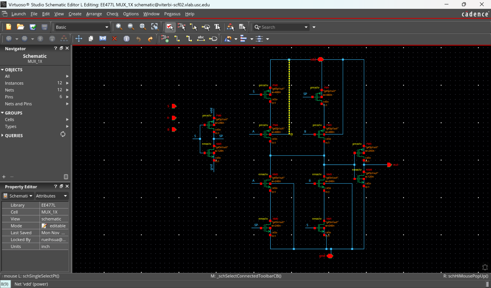 | 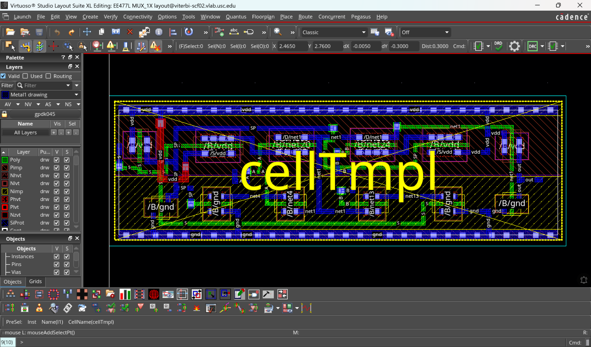 |
| 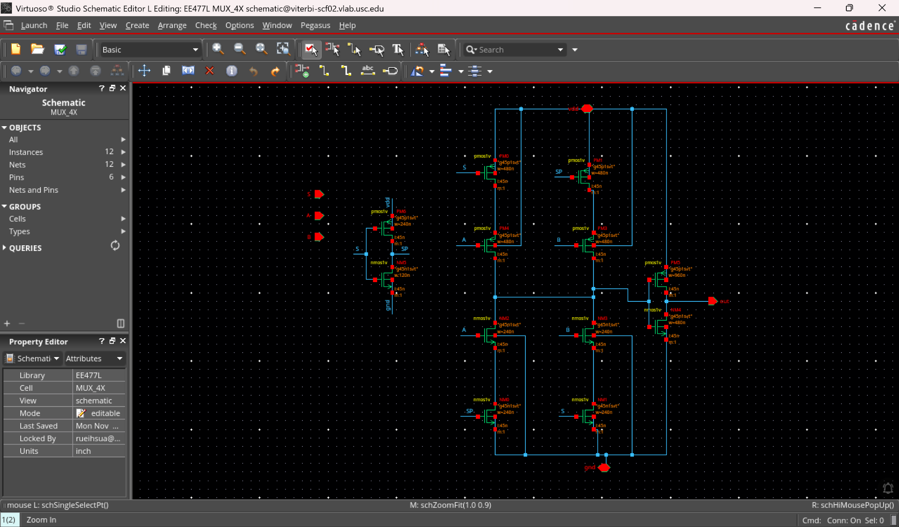 | 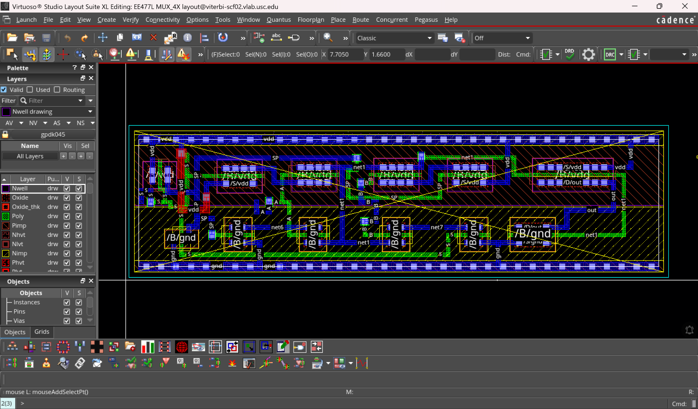 |

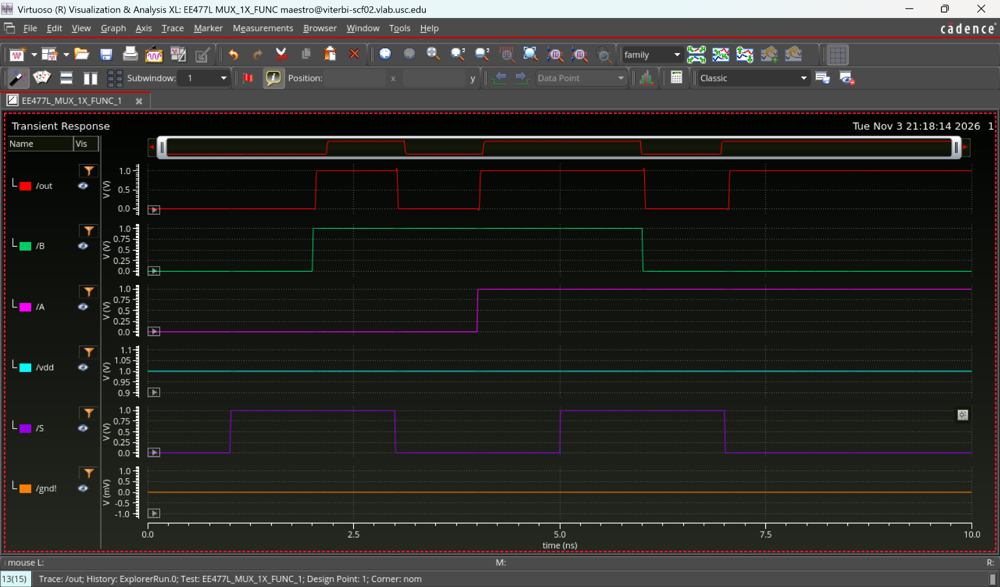

The DRC, LVS, and waveform screenshots for every cell are in [`docs/mux/`](docs/mux).

## 2. Carry-Skip Adder Schematic

**4-bit carry-skip block (CSKA4):** a 4-bit RCA built from my Lab 2 full adders, a block-propagate circuit, and a skip MUX. I made the block into a symbol.

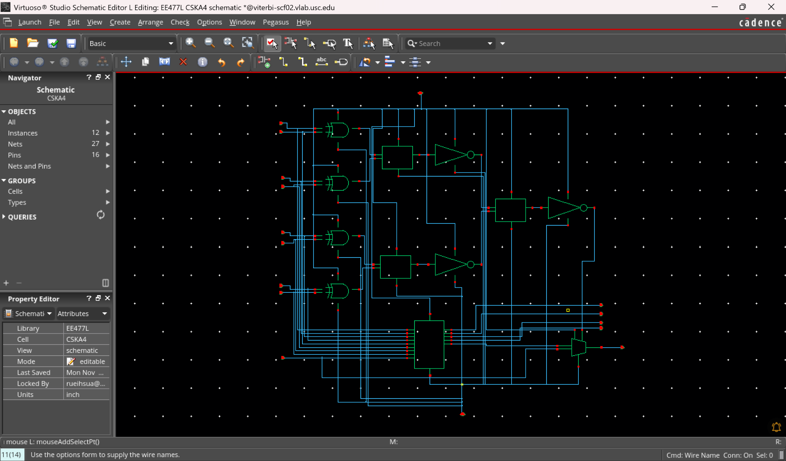

**8-bit adder (CSKA8):** two CSKA4 blocks in cascade. The inputs are `A[7:0]`, `B[7:0]`, and `Cin`, and the outputs are `S[7:0]` and `Cout`.

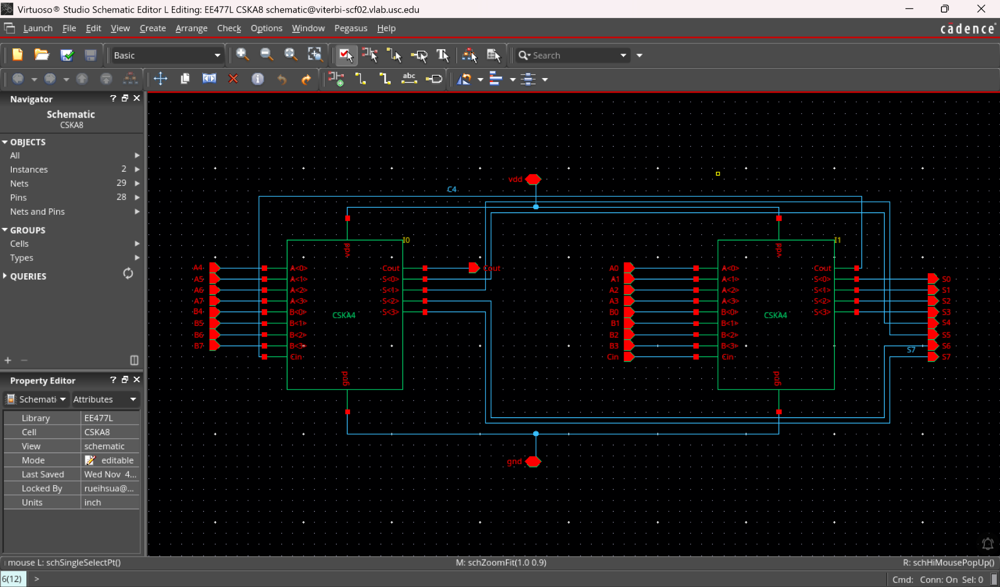

## 3. Functional Verification

| # | A (hex) | B (hex) | Cin | Expected S (hex) | Expected Cout | Schematic | Post-layout |
|---|---|---|---|---|---|---|---|
| 1 | FF | 00 | 0 | FF | 0 | ✅ | ✅ |
| 2 | FF | 01 | 0 | 00 | 1 | ✅ | ✅ |
| 3 | 0F | 01 | 0 | 10 | 0 | ✅ | ✅ |

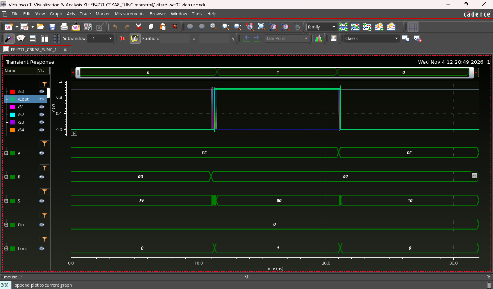

### Critical path

Test case 2 (`FF + 01`) is the **worst case**:

1. Bit 0 *generates* a carry (`A0 = B0 = 1`), so `P0 = 0` and `BP0 = 0`. Block 0 cannot skip, and the carry **ripples through FA1 → FA3**, then MUX0, to reach C4.
2. In block 1 every bit propagates, so `BP1 = 1` and **Cout skips** through MUX1. The **sum bits** still need the carry to ripple through FA4 → FA7, which makes **S7 the latest output**.

The post-layout waveform for this transition shows the sum bits switching one after another, from S0 to S7, as the carry ripples. S7 settles roughly 0.4 ns after the input edge. This is read from the waveform, not a formal delay measurement.

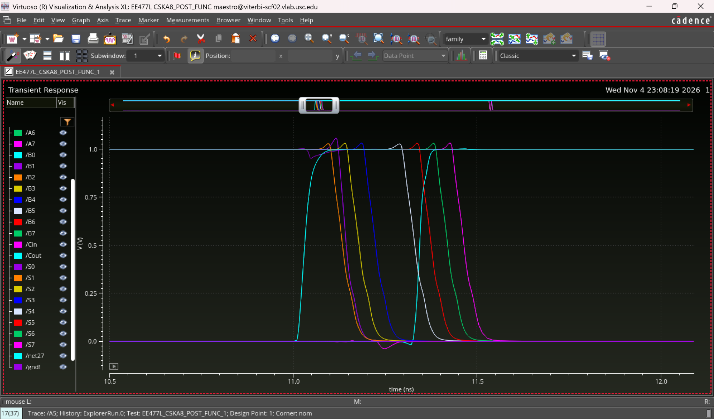

## 4. Layout

| Item | Result |
|---|---|
| DRC | ✅ 0 violations (562 rule checks) |
| LVS | ✅ Clean / Match |
| Area | 584.905 µm × 226.47 µm = **132,463.44 µm²** |

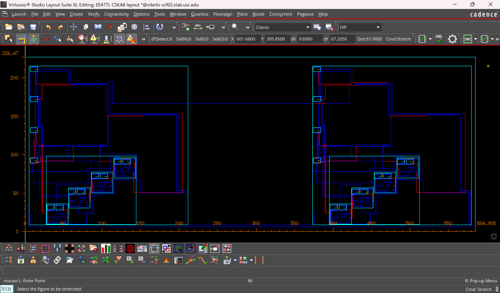

| DRC | LVS |
|---|---|
| 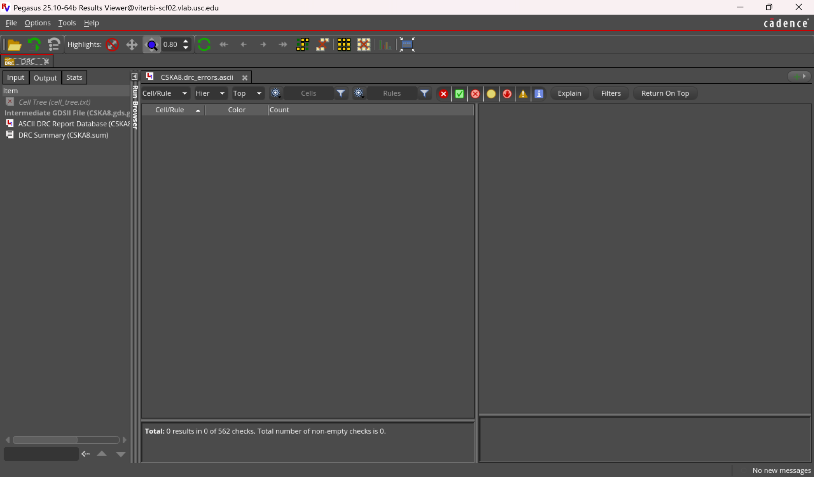 | 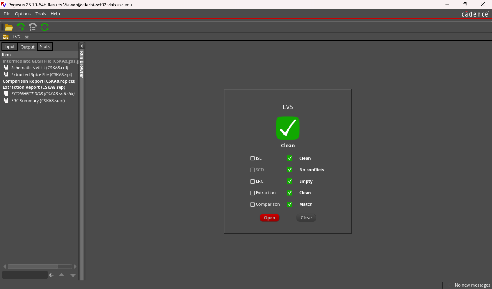 |

Post-layout functional result (same three test cases):

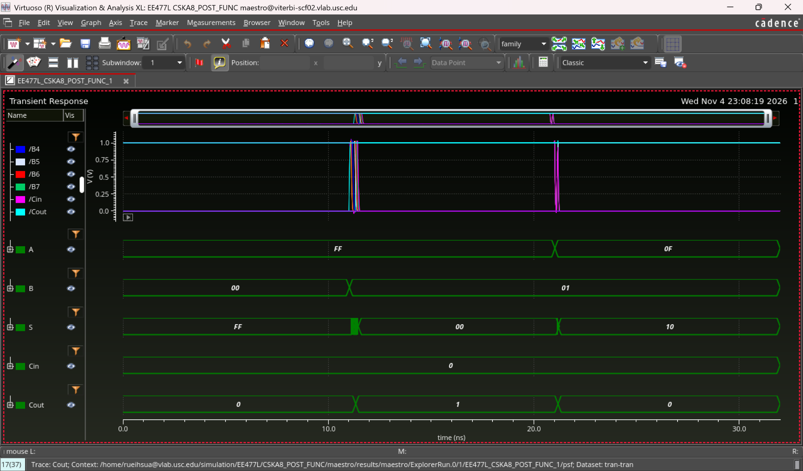

## Key Takeaways

- **Architecture:** Using the propagate signal (`P = A ⊕ B`) lets the carry bypass a whole block. This trades a small amount of area for a shorter carry path. The first block's ripple is still on the critical path, which is why real designs often use variable block sizes.
- **Cell sizing:** I built a 1X/2X/4X cell family by resizing only the output stage, which keeps the input capacitance constant.
- **Full-custom flow:** schematic → symbol → hierarchical layout → DRC/LVS → post-layout simulation with realistic input drivers and output loads.

## Repository Structure

```
docs/
  mux/    MUX_1X/2X/4X: schematic, layout, DRC, LVS, waveforms
  cska/   CSKA4 / CSKA8 schematic, layout (with rulers), DRC, LVS, pre/post-layout waveforms
```

> The PDK and Cadence library files are not included because of license restrictions. This repository contains only screenshots and documentation.
